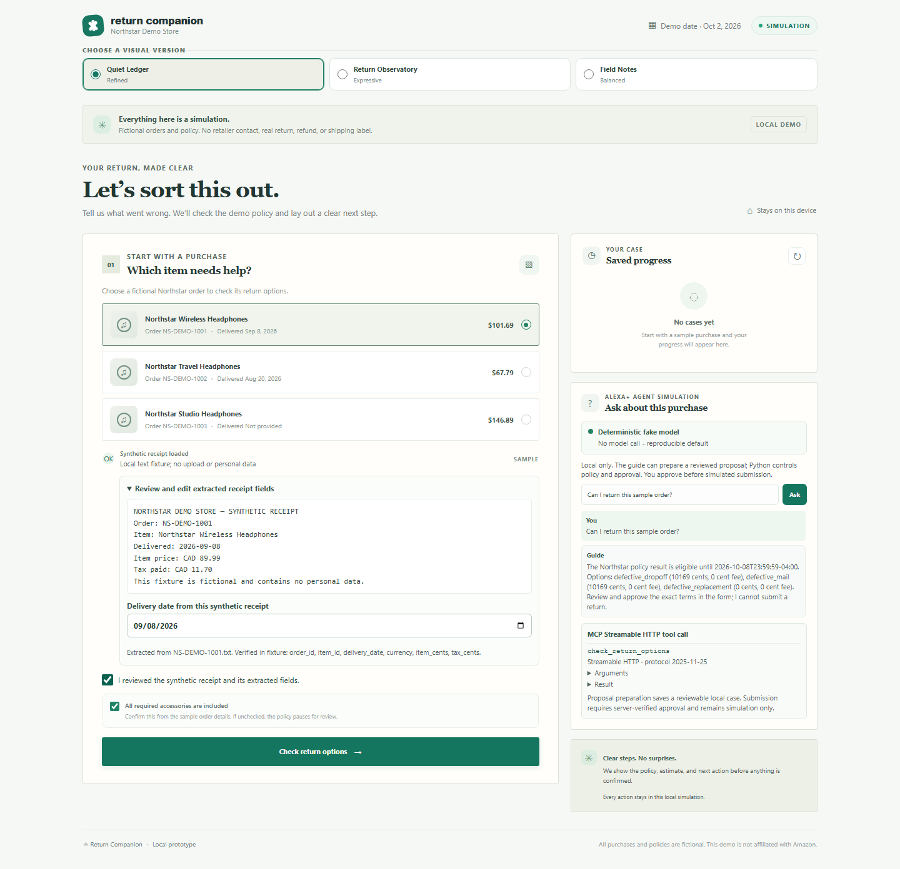
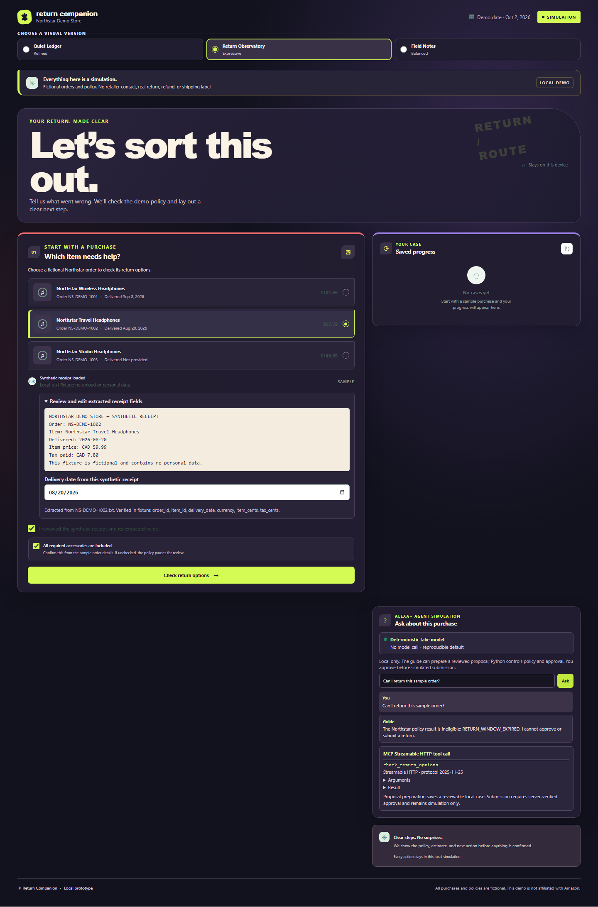
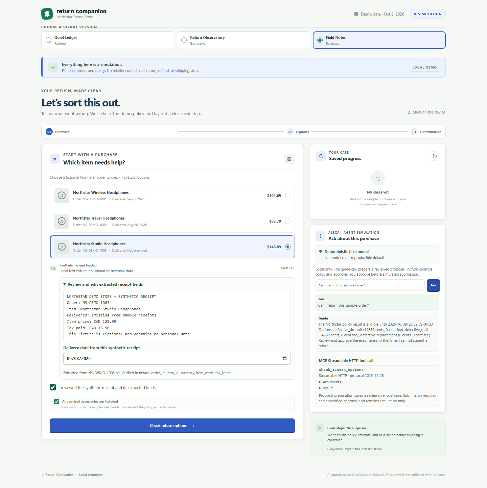

# Design directions

The three design directions share the same local synthetic workflow. Switch them using the keyboard-accessible **Choose a visual version** radio group near the top of the app.

## Quiet Ledger

Paper tones, restrained green accents, thin borders, and serif display headings.

## Return Observatory

A dark plum interface with lime and coral accents and an asymmetric dashboard composition.

## Field Notes

A balanced, light dashboard with cobalt accents and a compact progress ribbon.

These screenshots use only the checked-in fictional Northstar purchase and policy fixtures. They contain no real account, order, or return data.
